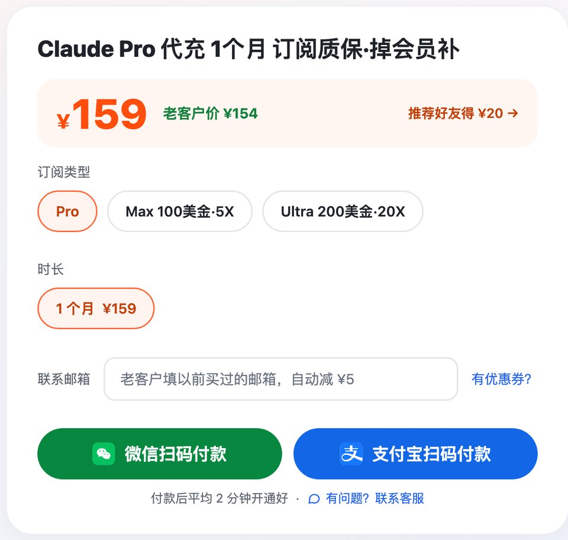
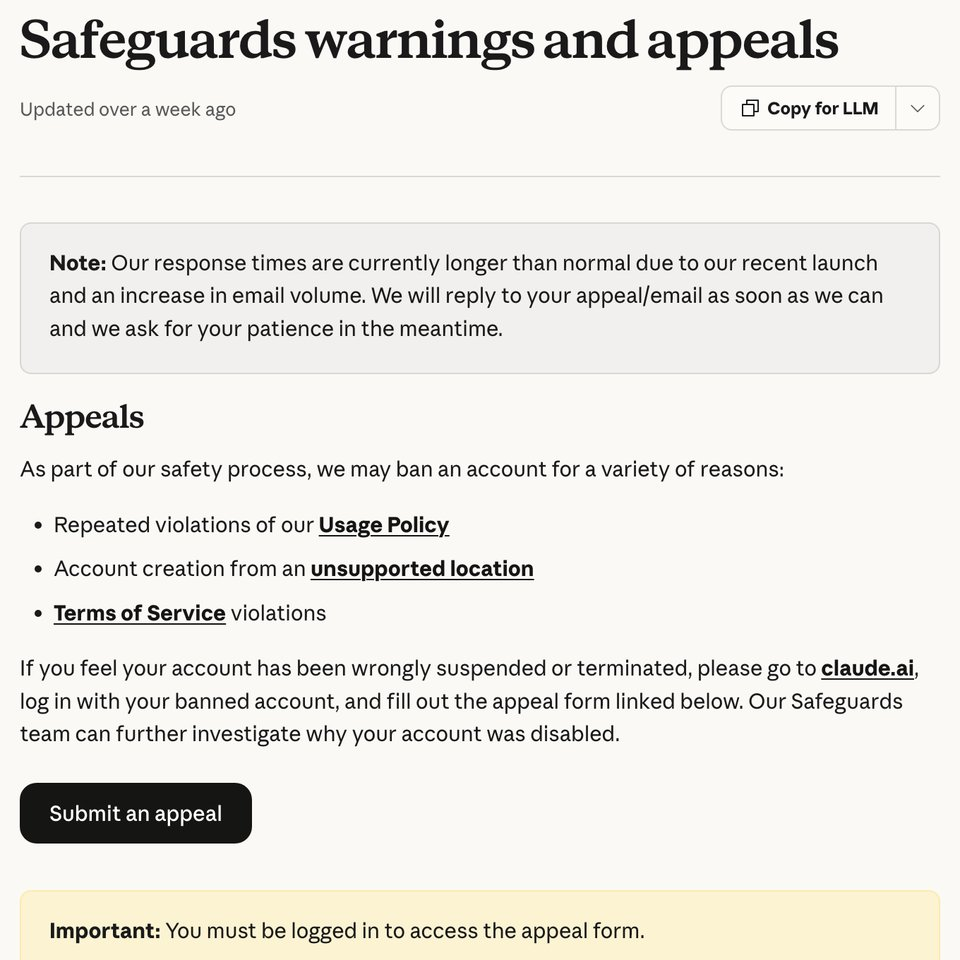
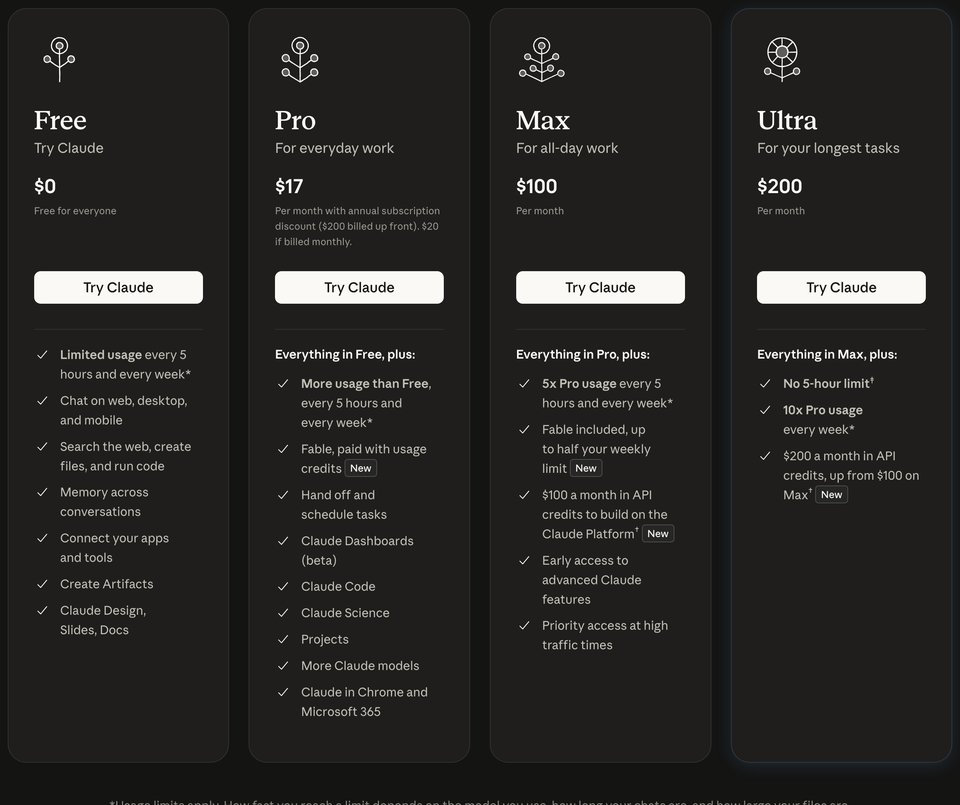

# Claude账号购买 2026：成品号靠谱吗、风险在哪、为什么自己号开会员更稳

> 2026-11-15 更新

**先说结论：** 搜 Claude账号购买 的人，多半是想马上用上会员。瑶瑶ai训练师的商城不卖成品号，只把会员开到你自己注册的号上：[Claude Pro 开到自己账号 ¥159 一个月](https://kw.yaoyao.chat/item/12?utm_source=github&utm_medium=readme&utm_campaign=claudehao&utm_content=top)，付款后填组织 ID，平均 2 分钟到账，不要密码；没开成重开或退款。下单填券码 **888888** 再减 ¥3。

- **成品号的问题**：注册邮箱和找回权在卖号的人手里，Anthropic 的条款又不许把账号给别人用；号一出事，申诉、导出聊天记录、找官方退款，都得靠那个你登不进的邮箱。
- **自己号开会员**：Pro ¥159、Max ¥900、Ultra ¥1,800，同一个下单页选档；本期内掉会员补一个月，全站近 30 天开通 598 单（2026-11-10 统计）。
- **谁不用买**：手里有能付外币的卡、人在官方支持地区的，claude.ai 自己订最省事；只是偶尔问几句的，免费版先用着。
- **顺带看看 ChatGPT**：店里成交最多的其实是 [ChatGPT Plus 一个月 ¥129](https://kw.yaoyao.chat/item/5?utm_source=github&utm_medium=readme&utm_campaign=claudehao&utm_content=plus-top)，一样开在你原来的号上。

*图：瑶瑶ai训练师商城 Claude 下单区，选中 Pro 时 ¥159，Max、Ultra 在同一排切换（kw.yaoyao.chat/item/12?d=pro，2026-11-10 截图）*

## 网上卖的"Claude 号"分三种，先认出来

在各个平台搜一圈，挂着"Claude 账号"的商品大致是这三类。名字五花八门，拆开看本质只有一个问题：账号到底归谁。

| 卖的东西 | 实际拿到什么 | 账号归谁 |
|---|---|---|
| 成品号（白号） | 别人注册好的免费号，给你邮箱和密码 | 卖号的人，他随时能改密码、找回 |
| 成品号带会员 | 别人注册、别人付了会员的号 | 同上，会员钱也不是你付的 |
| 合租、拼车号 | 几个人共用一个会员号，各自登录 | 号主，你只是"借用" |
| 会员开到自己号 | 你自己注册，卖家只替你交会员费 | 你自己 |

前三种都绕不开一件事：登录凭据是别人给的，邮箱也是别人的。最后一种才是"买会员"，跟"买账号"不是一回事。瑶瑶店里只做最后一种，所以这篇不推荐买任何成品号，把风险摆出来，你自己掂量。

拼车那一类，ChatGPT 那边已经有不少人吃过亏，道理相通，可以顺手看看 [ChatGPT 会员能几个人共享](https://kw.yaoyao.chat/guide/chatgpt-gongxiang.html?utm_source=github&utm_medium=readme&utm_campaign=claudehao&utm_content=guide)；成品号和代充的区别，ChatGPT 版本也单独写过：[成品号和代充有什么区别](https://kw.yaoyao.chat/guide/plus-chenpinhao.html?utm_source=github&utm_medium=readme&utm_campaign=claudehao&utm_content=guide)。

## 官方条款怎么说：账号不能转给别人用

下面几句都出自 Anthropic 公开的文件，2026-11-10 逐条读过：

- **消费者条款**：不得把账号登录信息、凭据分享给任何人，也不得把账号提供给别人使用；账号下的所有活动由账号持有人负责。条款本身不经 Anthropic 书面同意不能转让。
- **使用政策**：禁止通过未经授权的方式转售、代理或向别人提供 Claude 的访问；禁止注册多个账号来躲避检测；禁止用另一个账号（包括新注册的、现成的）绕过封禁。
- **账号停用的原因**（帮助中心《Safeguards warnings and appeals》）：一再违反使用政策、从不受支持的地区注册、违反服务条款，三条。

把这三处放一起看就明白：成品号从诞生那天起，就跟"不得提供给别人使用"对着干。它能用多久，取决于系统什么时候注意到它，而不是卖家承诺的"包用一个月"。

还有一层地区的事。Anthropic 的支持地区页写明，名单外的地区一律不支持，人在名单外的地方使用也算不支持；名单里没有中国大陆、香港和澳门。很多成品号是批量注册的，注册环境本身就可能落在帮助中心列的停用原因里，买家完全看不到。

*图：Claude 帮助中心《Safeguards warnings and appeals》官方页面截图，列出停用账号的三种原因，并写明申诉要先用被停用的账号登录（support.claude.com，2026-11-10 截图）*

## 成品号最常见的五个坑

**一、卖家一直握着找回权。** 你拿到的是邮箱加密码。邮箱不是你的，对方哪天改密码、用邮箱验证码登回去，你一点办法没有。有的卖家"换绑邮箱"，可原注册信息、付款记录仍对不上你。

**二、多人同时在用。** 同一批号卖给几个人，或者卖家自己留着用，是常有的事。几个地方同时登录，正好撞上条款里"不得提供给别人使用"。

**三、会员说没就没。** 带会员的号，会员是谁付的、用什么卡付的，你不知道。付款一被撤回，订阅就退回免费版，聊天正写到一半也一样。

**四、出事没处讲理。** 你跟 Anthropic 之间没有任何付款关系。官方退款要从账号里提交，你连邮箱都没有，提交不了；卖家那头"售后"往往就是再给一个号。

**五、聊天记录是"寄存"在别人号上的。** 你写进去的代码、文档、项目说明，全在一个不属于你的账号里。号被收回或停用，这些东西跟着走。最后这条，下一节单独展开。

想看正规的"开到自己号上"是什么流程，可以对照 [支付宝开 Claude Pro 怎么开通](https://kw.yaoyao.chat/guide/claude-pro-daichong.html?utm_source=github&utm_medium=readme&utm_campaign=claudehao&utm_content=guide) 里的几个检查点，或者更通用的 [AI 会员代充下单前 8 项自查](https://kw.yaoyao.chat/guide/heshi-maijia.html?utm_source=github&utm_medium=readme&utm_campaign=claudehao&utm_content=guide)。

## 成品号被找回、被封：聊天记录和钱怎么办

这是买成品号的人最晚才想到、又最疼的一块。按官方现在的流程，一件件对一下：

**被原主找回了。** 对方在登录页走一遍邮箱验证就进去了，你这边直接被踢出。条款写的是账号持有人对账号负责，持有人就是邮箱的主人。这种情况没有官方渠道能帮你"抢回来"，聊天记录也随号归对方。

**号被停用了，想申诉。** 帮助中心写得很直白：申诉要去 claude.ai，用被停用的账号登录后才能看到申诉表；不登录看不到。登录又要邮箱验证码，所以成品号买家多半卡在第一步。

**想先把聊天记录导出来。** 官方的导出入口在网页或桌面版的 Settings → Privacy → Export data，处理好以后，下载链接会发到账号绑定的邮箱，24 小时后失效，而且要登录同一个账号才能下载。帮助中心还写了：因为违反使用政策被停用的 Free、Pro、Max、Ultra 账号，仍可以登录去导出数据或删除账号，但能导出的内容可能受限。导出包里也不含你当初上传的原始文件。邮箱不在你手里，这条路基本走不通。

**想找官方退会员费。** 帮助中心的退款流程是：登录账号，点左下角名字，进 Get help，选 Claude Refund Request 按提示走；官方同时写明，除条款明确规定、法律要求或欺诈外，付款一律不退。登不进账号的，要用别的邮箱联系官方支持、并抄送账号绑定的那个邮箱。成品号的会员钱不是你付的，也不是你的邮箱，这两步你一步都做不了。

**找卖家。** 只能看卖家自己写的规矩。很多成品号卖家的"包售后"只是补一个新号，前一个号里的东西照样拿不回来。

所以真心建议：哪怕已经买了成品号在用，也别在里面放唯一一份的重要资料，定期复制到本地；更稳的做法是换回自己注册的号。

## 为什么自己号开会员更稳

自己号开会员，前面那五个坑大多自动消失：

- 邮箱是你的，找回权在你手里；停用了能自己登录申诉、自己导出数据。
- 只有你一个人登录，不存在"同一个号卖给几个人"。
- 会员到期回到免费版，聊天记录、项目都还在原号上，下个月续上就接着用。

瑶瑶店里怎么开：在 claude.ai 注册好自己的号（[国内怎么注册 Claude 账号](https://kw.yaoyao.chat/guide/zhuce-zhanghao.html?utm_source=github&utm_medium=readme&utm_campaign=claudehao&utm_content=guide)），确认能正常登录、眼下是免费版；在下单页选档付款；付款后在订单页填组织 ID（claude.ai 设置 → Account 里复制，一串编号，拿着它登录不了你的号）。平均 2 分钟到账，全天 24 小时都能下单，不用先加微信。开好以后，登出再登入，看套餐名有没有变；还显示 Free 的，照 [Claude 充值了还显示 Free Plan 怎么办](https://kw.yaoyao.chat/guide/claude-free-plan.html?utm_source=github&utm_medium=readme&utm_campaign=claudehao&utm_content=guide) 一项项查。

档位按用量选：写作、读资料为主的先开 Pro；每天在 Claude Code 里写几个小时代码的，看 [Claude Max 一个月 ¥900](https://kw.yaoyao.chat/item/12?d=max5x&utm_source=github&utm_medium=readme&utm_campaign=claudehao&utm_content=mid)；三档官方用量差别，官方定价页的对比表写得最清楚。

两条店规要提前知道：一是号上正挂着 Pro、Max 或 Ultra 的，店里能下单但没法覆盖充值，得换一个不是会员的号来开；二是封号不在质保范围、不退款，Claude 封号瑶瑶协助按官方渠道申诉，结果以官方为准。店铺资质、交易方式和售后数字见 [瑶瑶ai训练师靠谱吗](https://kw.yaoyao.chat/guide/yaoyao-kaopu.html?utm_source=github&utm_medium=readme&utm_campaign=claudehao&utm_content=guide)。

ChatGPT 也在用的，Plus 包含什么、一次买几个月，看 [ChatGPT Plus购买指南](https://github.com/yaoyao-chat/plus) 就够了；同样开在自己号上的 [Plus 1 个月 ¥129](https://kw.yaoyao.chat/item/5?utm_source=github&utm_medium=readme&utm_campaign=claudehao&utm_content=plus-mid) 也在店里。

## 自己注册卡住了，常见三处

| 卡在哪 | 你看到的 | 怎么想 |
|---|---|---|
| 地区 | 注册页、登录页提示服务不可用 | 支持地区名单里没有中国大陆、香港、澳门，这是官方规定，绕不过去也不建议硬绕 |
| 手机验证 | 收不到验证码 | 以注册页提示为准，国内号码常收不到 |
| 付款 | 卡被拒、没有支付宝 | 官网付款写的是信用卡；没有外币卡的，再考虑代付 |

前两处是"能不能有号"，第三处是"能不能开会员"。很多人买成品号，其实只是第三处过不去，那完全可以只解决付款这一步。几种开通路线的利弊并排比过，见 [Claude Pro 国内怎么买：5 条路线对比](https://kw.yaoyao.chat/guide/claude-luxian-duibi.html?utm_source=github&utm_medium=readme&utm_campaign=claudehao&utm_content=guide)。

*图：Claude 官方定价页截图，Pro 按年折合每月 17 美元、按月 20 美元，Max 100 美元，Ultra 200 美元，标价不含税（claude.com/pricing，2026-11-10 截图）*

## 常见问题

**问：Claude账号购买 和代充有什么区别？**
账号购买是拿别人的号来用，代充是会员开在你自己的号上。前者邮箱和找回权在卖家手里，后者账号始终是你的。

**问：买的 Claude 成品号会被封吗？**
官方没公布风控细则。但条款不许把账号给别人用，使用政策禁止转售访问，从不受支持地区注册也是官方列明的停用原因，成品号同时踩着好几条，风险明显更高。

**问：成品号被封了，卖家说包换，聊天记录还能要回来吗？**
换的是新号，旧号里的内容不会跟过去。导出要登录原账号、链接发到原邮箱，邮箱不是你的就拿不到。

**问：买了带 Pro 的成品号，到期了能在瑶瑶店里续吗？**
等它回到免费版后可以下单开，但号的归属问题还在。更建议直接拿自己注册的号来开。

**问：自己号被封了，能注册新号接着开吗？**
官方 [使用政策](https://www.anthropic.com/legal/aup) 禁止用另一个账号绕过封禁。先用原号登录 [申诉页](https://support.claude.com/en/articles/8241253-safeguards-warnings-and-appeals) 提交，等官方结果；在瑶瑶这里开的，把订单号和停用邮件截图发到企业微信，协助你走官方流程。

**问：瑶瑶店里开 Claude 要给什么？**
只要组织 ID。密码、邮箱验证码、证件照都不用给，谁要都别给。

**问：能开发票吗？**
可以开，也能对公转账；下单后把订单号和抬头发到企业微信，票种开票前确认。

确定走"自己号开会员"这条路的，三档都在 [Claude 会员开到自己账号：Pro ¥159、Max ¥900、Ultra ¥1,800](https://kw.yaoyao.chat/item/12?utm_source=github&utm_medium=readme&utm_campaign=claudehao&utm_content=end)，结账填 **888888** 照样减 ¥3（全店通用，不和推荐码、老客户减 ¥5 同时用）。

## 相关教程

- [ChatGPT Plus购买指南：GPT会员有什么、买几个月](https://github.com/yaoyao-chat/plus)
- [Claude Code价格](https://github.com/yaoyao-chat/claudecode)：哪档能用、额度够不够
- [Claude订阅：Pro / Max 开通和 Claude Code](https://github.com/yaoyao-chat/claude)

## 核对与来源

官方部分 2026-11-10 当天打开原页面逐条核对；条款和政策随时会改，以官方当前版本为准。

- [Anthropic 消费者条款](https://www.anthropic.com/legal/consumer-terms)：不得分享登录信息、不得把账号提供给别人；条款不能未经同意转让；付款除另有规定外不退；因违约被终止的订阅不退款
- [Anthropic 使用政策](https://www.anthropic.com/legal/aup)：禁止未经授权转售、代理访问；禁止多账号躲检测；禁止用另一个账号绕过封禁
- [Safeguards warnings and appeals](https://support.claude.com/en/articles/8241253-safeguards-warnings-and-appeals)：三种停用原因；申诉要用被停用的账号登录；被停用后可登录导出数据或删除账号，导出内容可能受限
- [Export your Claude data](https://support.claude.com/en/articles/9450526-export-your-claude-data)：Settings → Privacy 导出；链接发到账号邮箱、24 小时失效、要登录才能下载；不含原始上传文件
- [Request a refund for a paid Claude plan](https://support.claude.com/en/articles/12386328-request-a-refund-for-a-paid-claude-plan)：从账号里提交退款；登不进账号要换邮箱联系并抄送原邮箱
- [Supported countries and regions](https://www.anthropic.com/supported-countries)：名单外一律不支持，名单里没有中国大陆、香港、澳门
- [Claude 官方定价页](https://claude.com/pricing)：Pro 按月 20 美元、按年 200 美元；Max 100、Ultra 200 美元；不含税；付款方式写的是信用卡

商城部分：价格、到账时间、售后、发票、近 30 天开通量出自商城事实卡（2026-11-10 02:44 统计）；会员中的账号不能覆盖充值、要换非会员号，是店主 2026-10-30 定的店内规则。

## 关于作者与声明

这篇出自瑶瑶ai训练师之手：2023 年 10 月起做 AI 科普，全网粉丝约 320 万，kw.yaoyao.chat 是她自己经营的店，文中指向商城的链接都属于自家广告。代充不算官方渠道，店铺和 Anthropic 没有隶属关系，也没拿过授权。不论对方是谁、哪怕自称瑶瑶客服，都别交出账号密码和验证码；客服只认企业微信 `kw.yaoyao.chat/wecom`。

原文地址：[github.com/yaoyao-chat/claudehao](https://github.com/yaoyao-chat/claudehao)（CC BY-ND 4.0，转载请保留原文地址、不得改编）
